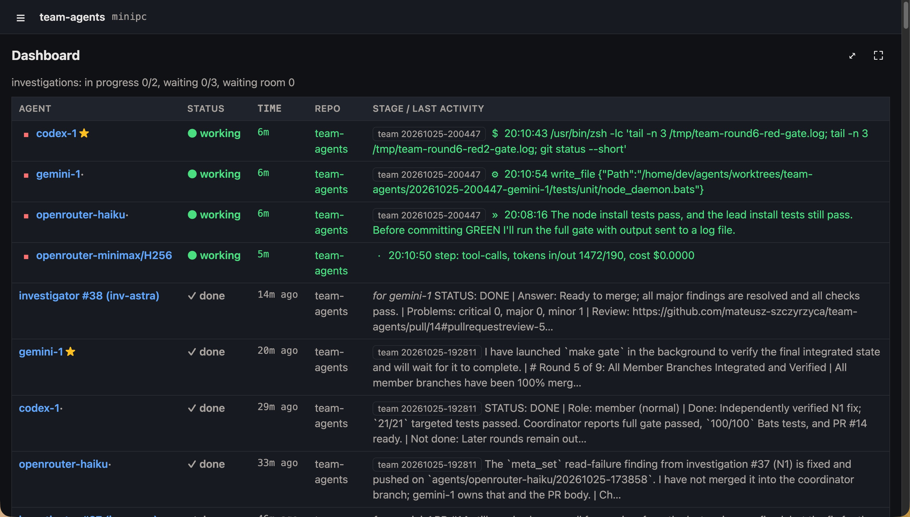

# team-agents

Run a crew of headless LLM coding agents on your own Linux machine and let them work on your repositories
in parallel — alone or as teams — while you watch, answer their questions and review their pull requests.



team-agents does not implement an agent loop itself. It orchestrates existing agent CLIs —
**Claude Code**, **Codex CLI**, **Antigravity CLI (`agy`)** and **OpenCode** (for any API provider such as
OpenRouter or DeepInfra) — and adds what they lack when several of them work unattended on one host:

- **Isolation:** every task runs in its own git worktree and branch, as a background `systemd --user` unit.
- **Communication:** a small MCP server (`agentbus`, Go standard library only) gives all agents a shared message bus,
  resource reservations (debug probes, serial ports, test hosts), a persistent per-repository notebook and
  checkpoints.
- **Human in the loop:** agents never guess; they write questions to a Markdown file, the task pauses, you answer
  with `agent answer <id>` (or just save the file marked `**ANSWERED**`) and the agent resumes in the same session.
- **Model tiers:** cheap "worker" models do mechanical work (searching, listing, summarising output) on behalf of
  stronger "normal" models; expensive "investigator" models are queued for hard problems and PR reviews.
- **Load spread across providers:** because agents of different CLI types (Claude Code, Codex, Antigravity,
  OpenCode with OpenRouter or DeepInfra) and different tiers work side by side, the load and the token usage are
  distributed over several providers and accounts instead of exhausting one subscription's limits or one API
  budget.
- **Teams:** several agents share one task; they elect a coordinator, run a qualification quiz, split work on a
  shared board, merge into one draft PR and finish together.
- **Robustness:** a hang watchdog, automatic resume, checkpoints and `agent run --resume`, provider load
  balancing, a kill switch (`agent stop --running`).
- **Observability:** a live terminal panel (`agent live`), unified activity logs across all CLIs, full transcripts
  and 7z archives of finished work.

It was built for embedded development on a Raspberry Pi 5 (agents flash and debug real boards), but nothing in
it is specific to that: it works for any repository on any Linux host with `systemd --user`.

> **Security warning.** Agents run with their CLIs' permission prompts and sandboxes **disabled**
> (`--dangerously-skip-permissions`, `--dangerously-bypass-approvals-and-sandbox`, `--auto`). They can run any
> command as the user they run under, push to your repositories and use every credential that user can read.
> Read the [Security](#security) section before installing.

## Contents

- [How it works](#how-it-works)
- [Concepts](#concepts)
- [Security](#security)
- [Requirements](#requirements)
- [Installation](#installation)
- [Configuration](#configuration)
- [Usage](#usage)
- [The live panel](#the-live-panel)
- [Web interface](#web-interface)
- [MCP tools available to agents](#mcp-tools-available-to-agents)
- [Files and state](#files-and-state)
- [Notifications](#notifications)
- [Logs](#logs)
- [Example: embedded development on a Raspberry Pi](#example-embedded-development-on-a-raspberry-pi)
- [Troubleshooting](#troubleshooting)
- [Development and tests](#development-and-tests)
- [License](#license)

## How it works

```
you ── agent run claude-1 "task" ──► systemd --user unit  agent-<task>-r<n>
                                       │  runner: worktree + branch, prompt, secrets
                                       ▼
                         claude -p | codex exec | agy -p | opencode run   (JSON event stream)
                                       │ MCP (stdio)                  │ events
                                       ▼                              ▼
                               agentbus serve  ◄──────►  ~/agents/bus   activity.jsonl ─► agent live
                                   (one per run)          state.json, messages.jsonl,
                                                          notebooks/, checkpoints/
```

- `agent` (bash) is the command you use. It creates tasks, starts runners as `systemd --user` units, builds
  prompts, classifies how each run ended, resumes sessions, wakes sleeping team members, dispatches
  investigators and workers, and sends notifications.
- `agentbus` (Go) is started by every agent CLI as an MCP server over stdio. All instances share state through
  files guarded by `flock`. It also provides helper subcommands for the script (queue handling, teams, the
  event normalizer that turns each CLI's JSON stream into one activity format).
- `agentlive` (Go, Bubble Tea) is the live panel behind `agent live`.

## Concepts

### Tasks and runs

`agent run <agent> "task"` (inside a git repository) creates a task: a worktree under `~/agents/worktrees`, a
branch `agents/<agent>/<timestamp>` and a directory `~/agents/tasks/<task id>` with the prompt, the raw event
stream, the activity log and the final message. A task can have several **runs** (after answers, after an
investigation, after being woken up); the agent CLI resumes the same session each time.

Every turn of an agent must end with a `STATUS:` line. The runner maps it to the task status:

| Agent says | Task status | What happens |
|---|---|---|
| `STATUS: DONE` | `done` | notification; in a team the coordinator's DONE finishes the whole team |
| `STATUS: QUESTIONS` | `waiting` | questions file `questions-N.md` → notification → you answer |
| `STATUS: INVESTIGATING` | `investigating` | waits for an investigator; resumes automatically with the result |
| `STATUS: SLEEPING` | `sleeping` | team members only; woken by messages and board items |
| `STATUS: FAILED` | `failed` | notification |
| no `STATUS` line | `waiting` | the last message is passed to you as a question ("what should the agent do next?") |

### Questions and answers

The prompts include a set of clarification rules (`prompts/clarification.md`): agents must not guess; if
anything that affects the result is unclear they write numbered questions to a file and stop. Agents that ask only
in their final message get their questions moved into a file automatically.

Every question comes with a **recommendation**: the option that makes the task simpler and less likely to go
wrong, why, and whose recommendation it is. In a team the coordinator first collects the members'
recommendations (`consult_start`, `AGENT_CONSULT_MIN` minutes, default 5; a member that does not answer in time is
shown as NO ANSWER, not as agreement) and sends questions that need research to an investigator; where the team
disagreed, the question shows the other views. A questions file without recommendations goes back to the agent
once.

```
## 1. Where should the cache live?
a) in memory — lost on restart
b) on disk — survives restarts, needs cleanup

**Recommended:** a) — nothing to clean up, restarts are rare here (coordinator; gemini-1 agrees, codex-1 preferred b)

**Verdict:**
```

You write your decision after `**Verdict:**`; **`ok` accepts the recommendation** (the agent gets the recommendation
spelled out). The labels are always these English words, whatever language the questions are in.

Answering:

- **Save the file with `**ANSWERED**` as its last line** — a systemd path unit notices the save and the answers are
  sent at once. If a verdict is missing you get a notification and nothing is sent; save again when complete.
  (Saved without the marker = still working on it.)
- or `agent answer <id>` (opens `$EDITOR`, validates, resumes), or `agent resume <id>` after editing the file.

**VS Code.** When you work on the agents' host through Remote-SSH, a new questions file opens in the VS Code window
connected to it (the newest one that responds). Set `QUESTIONS_EDITOR=off` to disable it; `VSCODE_SERVER_DIRS`
lists the server directories searched (default: VS Code, VS Code Insiders, Cursor).

The path unit (`agent-<task>-answers-<round>.path`) does not survive a reboot of the host: after one, answer with
`agent resume <id>`.

### Model tiers and providers

- **Normal agents** (`NORMAL_AGENTS`) do the real work and may coordinate teams.
- **Workers** (`WORKER_AGENTS`) are cheap models. They never coordinate. They take `easy` items from a team's
  board and handle `delegate` requests: a normal agent hands over a mechanical job, the script starts a free
  worker as a helper task on a copy of the requester's branch, and the result comes back as a message.
  Requests are balanced across providers (the provider with the fewest working workers wins).
- **Investigators** (`INVESTIGATORS_TYPE`) are expensive models in a shared queue. An agent stuck on a hard
  problem calls `request_investigation`; it ends its turn, an investigator works on a copy of its branch, and
  the agent resumes with the result and must record a decision before acting on it. The queue holds one
  request in progress per investigator plus `INVESTIGATION_QUEUE_MAX` waiting ones. Requests rotate across
  the investigators: each goes to the next free one after the last one, preferring another provider than the
  last one's — no provider gets every investigation and review.

**Why mix tiers and providers.** Every subscription has usage limits (per few hours and per week) and every API
key has a budget. Splitting the agents into CLI types and tiers spreads the load and the token usage across
providers and accounts:

- normal agents of different types (for example `claude-1`, `codex-1`, `gemini-1`) draw on three separate
  subscriptions, so a team can work in parallel without one account hitting its limit;
- the token-hungry mechanical work (reading many files, long command output) goes to workers on pay-per-token
  providers (OpenRouter, DeepInfra) at a fraction of the price, instead of eating the subscriptions' limits;
- worker requests and board items are assigned to the provider with the fewest working agents, so the work is
  balanced across providers, not only across agents;
- the most expensive models (investigators) are used only for the problems that need them, through a queue.

### Teams

`agent run --team a,b,c "task"` gives one task to several agents, each on its own branch:

1. A normal member becomes the **coordinator** with `claim_lead` (the first one wins).
2. The coordinator runs a **qualification quiz**: one precise question from the task's domain with a 60 s
   limit. Answers are private; members who fail are excluded for this task and you are asked whether to
   continue.
3. The coordinator splits the work on a **board** (`easy` items for workers, `normal` items for normal models),
   opens a **draft PR** from its branch and merges every finished part into it, saving **checkpoints** along the
   way. Members push their branches after every commit. Idle members sleep and are woken by messages or by
   board items they have not seen yet (see [Waking, pausing and quotas](#waking-pausing-and-quotas)). An item
   for one particular member is added with `for=<member>`: only that member may claim it and only it is woken.
4. Only the coordinator asks you questions; members ask the coordinator.
5. The coordinator's `STATUS: DONE` (after `gh pr ready`) finishes the team.

With `--verify` the coordinator's DONE is checked first (PR exists and is not a draft, everything is pushed,
members' branches are merged); if something is missing the coordinator is sent back once with the list. Then an
investigator reviews the PR and publishes a GitHub review (as a comment — GitHub does not let an author approve
their own PR), and you get a notification with the recommendation.

**Before the review.** The round goes to review only when its head passes two checks, run in their own unit once
the team's members have settled: a change of code adds tests (new test cases; a round with documentation only is
exempt), and the repository's gate (`AGENT_REVIEW_GATE`, `make gate` by default) passes at that head. Else the
round goes back to the team with the reason — the gate's output — at most `AGENT_PRECHECK_MAX` (2) times, then
you decide.

**Texts on GitHub.** The agents write code in blocks that name their language, commits and PRs as links, and RED
and GREEN bold in red and green (`prompts/writing.md`). Before an `--autopilot` review a PR description that does
not goes back to the team once, with what to fix.

**The verdict.** A review ends with `VERDICT: ready-to-merge | needs-fixes | incomplete`, and its notification
shows it: ✅ ready to merge, 🔧 needs fixes, 🧩 incomplete, ❌ a review without a verdict. Critical or major
findings outweigh a "ready-to-merge".

**`--autopilot`** (it implies `--verify`) asks two investigators at once, each on its own — they do not read each
other's review, and a re-review gets only its own previous one; it waits until two are free, never one. Both
`ready-to-merge`: you get "✅✅ both reviews: ready to merge". Anything else: the team fixes what the reviews that
found problems say (the fix loop below).

After two `ready-to-merge` reviews the script merges the PR (`gh pr merge --merge`, a merge commit: the red and
green commits stay), runs the gate on the merged base and starts the next round of the plan — "🔀 merged" tells
you each time; after the last round it stops. A PR waits for you instead when it touches a path in
`AUTO_MERGE_HUMAN_PATHS` (`install.sh .github/ systemd/ AGENTS.md`; a directory ends with `/`) or changes
existing tests. The gate failing on the merged base stops it ("⛔ autopilot stopped"; the merge is not undone).
`agent autopilot <team> off` lets the round's reviews go on but merges nothing and starts nothing by itself;
`on` turns it back on. Two reviews waiting longer than `AGENT_REVIEW_WAIT_MIN` (30) minutes for two free
investigators are reported once — they go on waiting, never one reviewer instead of two. Nobody answers questions in
`--autopilot`: an agent's questions go back to it once — it takes the option it recommends, or the simplest safe
one, and lists its decisions in the PR under "Decisions taken without the human", which the reviewers check;
questions asked again in the same round come to you. A review that ends without a verdict — its run
failed, hung or was stopped, or its investigator's provider is out of quota — does not stop the pair: with the
other review asking for changes the fix pass goes on with its findings; with the other ready to merge it is done
again, once, by another free investigator (one out of quota is not chosen until its reset), and only then comes
to you. A team closed because all its members finished — its coordinator out — goes to review too. A spent budget
("Workspace monthly budget … exceeded") is a quota pause until its reset, also given as an ISO time. On the lead a
remote member's pause shows with its reason, and its failure with the CLI's exit code and last error line. It
merges only the commit that passed its checks and both reviews (`--match-head-commit`): anything pushed since stops
the merge.

**What the agents read on GitHub.** Only the trusted accounts (`AGENT_GITHUB_TRUSTED`) may steer the agents. Their
CLI gets `agent` itself as `gh` (a link named `gh`, first on its `PATH`, filters what it reads): comments and reviews by anyone else — on open, closed and
merged PRs and issues alike — are left out and logged (`github_comment_ignored`: "there is unknown comment from
unknown user and it's ignored"), and so are the trusted accounts' own that begin with "ignore this mate", a way to
check it on GitHub's real data (`github_comment_marked_ignored`). A fork's PR, or one opened by another account, is
not shown at all, and a GraphQL query for comments or reviews is refused. This keeps other people's text from
reaching an agent; it does not hold back an agent that bypasses `gh` with its token, so limit who may comment
(the repository's interaction limits) and what the agents' token may do (a fine-grained token for this repository).

**The fix loop.** When the review finds critical or major problems, the team is woken with them: the review is
added to its task ("Fix pass 1 of 2"), it fixes them (or disputes one on the PR) and finishes again — and the PR
is reviewed again, a re-review that first checks the previous findings. After `VERIFY_MAX_FIX_PASSES` (2) fix
passes with critical or major problems still found, the team is not woken again: the human is mentioned on the
PR (`AGENT_HUMAN_GITHUB`, default the GitHub owner of the repository) and notified. The review gives, for each
problem, the simplest fix that resolves it.

### When a member drops out

A member can drop out of a team's work: its run fails, it is paused for long (an exhausted quota), or its runner
dies. Its work stays outside its head — board items with progress notes (`board_progress`, after every push),
its pushed branch, the checkpoints — so the others finish it:

- **A failed run or a dead runner:** its board items go back to the board, with its progress note and who held
  it (`previously:`), and the coordinator and the normal members get one message: who is out, why, which items,
  its branch and last commit. Whoever takes an item over continues from that branch unless the note says the
  approach failed.
- **A pause longer than `AGENT_RELEASE_PAUSE_MIN`** (20 min): its items go back the same way; when it resumes it
  hears which ones and takes new work from the board. A shorter pause (an HTTP 429) keeps its items.
- **The coordinator's failed run** does not close the team: its members hear that it is out and a normal model
  takes over coordination (`claim_lead`) from the last checkpoint, the board and the PR; you are notified.
- **A dead runner** (a reboot, a killed process) is found by `agent-supervise.timer` (every 3 minutes, installed
  by `install.sh`), which ends the task and tells its team.
- **An unknown STATUS** (e.g. `BLOCKED`) goes back to the agent once with the statuses that exist — blocked by
  someone else's work is `SLEEPING`; a second one fails the run.

### Checkpoints and resuming

Resuming never throws away uncommitted work: a task's uncommitted changes (untracked files included) go to the
stash and on into its new worktree; when a new round starts on a fresh branch they stay in the stash, named in the
output (`git stash apply <sha>`).

Agents commit and push in small steps and call `checkpoint(summary, next_steps)` after every stage. If you stop
work — typically to extend the task — `agent run --resume <team|task> "addition"` starts the same agents on the
same branches (and the same draft PR), with the checkpoints, the earlier answers and your addition in the
prompt. A resumed team keeps its coordinator and board and skips the quiz.

Ordinary starts and `run --resume` reserve fresh timestamp-shaped task IDs and team IDs under the local
`task-ids.lock`. If a timestamp is already occupied, allocation tries the next second. The whole team's task
directories are claimed before a resume replaces any previous worktree, so immediate stop/resume preserves the
original task text and metadata. Existing IDs and metadata remain readable; ordinary resume keeps its branches
as before. Concurrent starts share the same reservation path, and release the lock before launching runners.
Preparation holds this lock through checkout and team registration, including a next-round fetch. Another start
waits up to 60 seconds for it, then reports an error and can be retried.

### Rounds

Big changes are not reviewable — so a task's PR has a size limit, and a bigger task is done in **rounds**, one
PR each:

- The size is added + deleted lines against the base, tests included, without the files matched by `ROUND_EXCLUDE`
  (generated code, vendored files, lock files). `ROUND_MAX_LINES` is the hard limit (default 3000), `ROUND_SOFT_LINES`
  what agents aim for (2000); `ROUND_MAX_LINES_REPO=([drafts]=0)` changes the limit per repository (0 = none).
  `agent round-size <task>` shows the size of a task's change (the agents use it too).
- At the start the agent (in a team: the coordinator) estimates the change. If it does not fit one round, it plans
  rounds and asks you to approve the plan. After each round `main` stays green: unfinished work is dead code or a
  stub. No test is written ahead of its round: a skipped test is an exception with a reason outside the code
  (a missing tool or device), listed in the PR description's `## Skipped tests` section (`docs/tdd.md`). Every
  run's prompt lists the repository's skipped tests, so they get filled.
- A round ends with `STATUS: ROUND_DONE N/M`. If its change is over the limit, or it adds a skipped test the
  PR does not list under `## Skipped tests`, it goes back to the agent to be split (at most `ROUND_BOUNCES` times, default 2; then it closes with a
  warning in the notification).
- The notification ("🔁 round N/M done") gives the PR. Merge it, then `agent run --resume <team|task>`: the next
  round starts on **new branches from the updated base** (the previous branches are kept and named in the task).
  `--resume` refuses while the round's PR is not merged; to keep working on the same round — review fixes —
  use `agent run --resume <team|task> --same-round "…"`.

### Test first

Agents write the test before the code (RED → GREEN → REFACTOR) and show it in the history: the test commit ends
with its failing run, the next one with the passing run. Where a test first is not possible, the commit says
`Test-First: not possible — <reason>`. The `--verify` review treats a change of behaviour without either as a
major finding. The rules and a worked example: [docs/tdd.md](docs/tdd.md).

### Waking, pausing and quotas

A sleeping member costs nothing; every wake-up starts a run and costs tokens. So:

- A **message** to a sleeping member (or to its team) wakes it.
- The **board** wakes a member only for work it has not seen yet: a new item at its level, an item returned to the
  board, or an item designated to it (`for`). An item it has already seen — in `board_list` or because it was
  woken for it — never wakes it again, even if it stays open.
- **Wake-loop guard.** A member that keeps being woken without doing anything — `AGENT_WAKE_LOOP_MAX` (default 4)
  idle runs in a row, an idle run being shorter than `AGENT_IDLE_RUN_SEC` (120 s) with no new commit and no bus
  message, or more than `AGENT_WAKE_RATE_MAX` (30) runs within 10 minutes — is **paused** for
  `AGENT_WAKE_LOOP_PAUSE_MIN` (15) minutes. You get a notification and the coordinator a `member_paused`
  message; the log shows `wake_loop_detected`.
- **Exhausted quota.** When a provider stops a run because its quota or usage limit is exhausted ("Individual
  quota reached… Resets in 24m46s", "usage limit reached", "try again in 2 hours", "resets 3pm"…), the task is
  **paused** until the limit resets (plus a minute; `AGENT_QUOTA_PAUSE_MIN`, default 30 min, when the CLI does
  not say when) instead of failing. This applies to solo tasks, team members, investigators and workers alike.
- **Overloaded model.** "Selected model is at capacity", "overloaded", HTTP 503/529: the provider has no room for
  that model right now — not your account. A short pause like a rate limit (`AGENT_RATE_LIMIT_PAUSE_MIN`).
- **Rate limit.** HTTP 429 / "too many requests" means the provider throttles requests — common on OpenRouter
  when the upstream provider is busy, with credits still available. The task is paused briefly
  (`AGENT_RATE_LIMIT_PAUSE_MIN`, default 5 min, unless the message gives a time), noted as rate-limited, not as
  an exhausted quota.
- Both are read only from the end of the run's errors (`AGENT_LIMIT_TAIL_LINES`, default 30 lines of stderr): a
  429 the CLI retried and got past does not pause a run that later ends without STATUS for another reason. The
  notification quotes the line that caused the pause.

A paused task (`⏸ paused` in `agent status`) does not run and is not woken by messages or the board; a systemd
timer (`agent-<task>-wake-<time>.timer`) resumes it at the announced time, in the same session. Its claimed board
items stay with it. To resume it earlier: `agent _wake <task>` after the time has passed, or edit `WAKE_AT` in
`~/agents/tasks/<task>/meta.env`; to give up on it: `agent stop <task>`.

### The hang watchdog

If a run shows no activity for `AGENT_HANG_MIN` minutes (default 30), it is killed. Normal agents,
coordinators and investigators are resumed in the same session and told not to repeat the hanging command; after
`AGENT_HANG_STRIKES` consecutive hangs without progress the agent is marked `hung`. Workers are not resumed —
the normal agents are told instead. A team fails only if the coordinator and all normal members are hung.

### Repository notebook

A persistent notebook per repository (an append-only log plus overwritable sections) carries knowledge between
tasks: device quirks, toolchain pitfalls, conventions. Agents read it at the start of every task.

## Security

team-agents gives AI models a shell without supervision. Treat the agents' user as untrusted: anything it can
read, the agents can read — and possibly leak, if a prompt injection (instructions hidden in a web page, an issue,
a dependency's README, a file in the repository) convinces an agent to do so. Design the setup so that a
compromised or confused agent can do as little damage as possible.

### Where to run it

- **Linux only for now** (it relies on `systemd --user`); macOS support is planned.
- **A dedicated machine or VM** — a small server, a Raspberry Pi, a VPS or a local VM — with nothing else of value
  on it: no personal files, no production credentials, no browser sessions, no password manager.
- **A dedicated, unprivileged user** for the agents, never your own login user. `~/agents` is created with mode
  `700`; keep it that way.
- **No sudo by default.** Passwordless sudo lets the agents install missing tools on their own, but it also lets
  them run anything as root: give it **at your own risk**, and preferably only on a disposable VM.
- **Nothing irreplaceable on the host.** Back up `~/agents/agents.conf`, `secrets.env` and `hardware.md`; be ready to
  rebuild the machine from scratch.

### Repositories and GitHub

Give the agents **their own GitHub account** ("machine user", allowed by GitHub's terms: one per person). Their
commits, pushes, pull requests and reviews then appear under that account instead of yours, their access can be
revoked in one place, and you can review and approve their PRs (an author cannot approve their own). How to grant
it access depends on who owns the repositories, because fine-grained tokens cannot be used for repositories where
their owner is only a collaborator:

- **Repositories in an organization (recommended).** Create a free organization for the projects, add the agents'
  account as a member with write access to the chosen repositories, and create a **fine-grained token** for that
  account with the organization as resource owner, only those repositories, Contents and Pull requests:
  read/write, Metadata: read, **no Workflows**, and an expiry date.
- **Repositories in your personal account.** Add the agents' account as a collaborator to the chosen repositories
  and create a **classic token** for it with the `repo` scope and **without** the `workflow` scope. A classic token
  is not limited per repository, but the account itself can reach only the repositories you shared with it.
- **No separate account.** A fine-grained token of your own account, limited as above. Commits still carry the
  agent's name (see [Commit identity](#commit-identity)), but pushes, PRs and reviews appear as you.

Put the token into `secrets.env` as `GH_TOKEN` (gh uses it instead of a stored login). In every variant:

- **No permission to change workflows** (Workflows / `workflow` scope), so the agents cannot touch
  `.github/workflows/`: a modified workflow runs with your CI secrets.
- For git over SSH use an SSH key of the agents' account, or a **deploy key** per repository — never your
  personal key.
- **Protect the main branch**: require a pull request with your review before merging, block force pushes and
  deletions. The agents open PRs; merging stays with you. Consider CODEOWNERS for sensitive paths.
- Do not give agents repositories with secrets in their history or committed `.env` files; treat everything an
  agent can read as potentially public.

### Other hosts (Ansible, test servers, devices)

- When agents work on infrastructure (for example an Ansible repository tested against a VPS), generate a
  **separate SSH key for them**, used for nothing else, and authorise it **only on test hosts** — never on
  production. Restrict it in `authorized_keys` where you can (`from="<agent host>"`, `restrict`), and remove it when
  the work is done.
- Prefer **disposable test hosts** (VMs or VPS instances you can rebuild from a snapshot) over long-lived servers.
- Devices attached to the host (debug probes, serial ports) can be flashed and reconfigured by the agents: connect
  only development boards, never devices in production use.

### Network

- Keep the agents' host **off the public internet**: no open inbound ports. A mesh VPN such as **Tailscale** (or
  WireGuard) is a good fit — and use its **ACLs** to limit what the agents' host may reach: the test hosts it needs,
  not your NAS, your laptop or the rest of your network (for example a `tag:agents` that can only reach
  `tag:test-hosts`).
- Optionally restrict outbound traffic with an egress firewall (nftables, OpenSnitch) to the providers, GitHub,
  package registries and the test hosts.

### Secrets and providers

- Create **separate API keys and tokens for the agents** in every service — Anthropic, OpenAI, Google, OpenRouter,
  DeepInfra, GitHub, the notification service — never reuse your personal or production keys. Separate keys can be
  revoked without collateral damage and show the agents' usage on their own.
- Set **spending limits and usage alerts** at the pay-per-token providers (OpenRouter lets you set a credit limit
  per key; check what budget or limit settings your other providers offer) so a runaway loop cannot run up a
  large bill.
- Remember that `secrets.env` and the CLIs' login files are **readable by the agents** — they run as the same user.
  Keep the scopes small and **rotate** the keys regularly, and immediately after anything suspicious.
- Notification hooks (`NOTIFY_CMD`) get their tokens from `secrets.env` too: use a token that can only send
  notifications.

### Security testing

Be careful with tasks such as "find vulnerabilities", "test the security of X" or penetration tests. An agent
looking for weaknesses may find them **on the machine it runs on** — a readable credential, a misconfigured
service, a local privilege escalation — and use them, because that is what the task asked for. Run such tasks only
against isolated, disposable targets, state the scope explicitly in the task ("only host X, nothing else"), and
never on the orchestrator's host or a network with anything you care about.

### Code, dependencies and review

- Agents install packages (pip, npm, cargo, go) — **malicious or typo-squatted packages** are a real risk. Use lock
  files, review dependency changes in the PRs, and prefer well-known packages.
- **Review every PR** before merging, especially changes to build scripts, CI configuration, install scripts and
  anything that runs with privileges. `--verify` adds an investigator's review, not a replacement for yours.
- Be wary of tasks that feed agents **untrusted input** (issues written by strangers, scraped web pages) while they
  hold write access: that is the classic prompt-injection path.

### Monitoring and response

- Ship the structured logs (`~/agents/logs/*.jsonl`, the journal) somewhere you look at, and alert on warnings and
  errors (see [Logs](#logs)). `agent transcript <task|team>` shows everything a task did, message by message.
- Logs and transcripts can contain secrets printed by commands: restrict who can read your log storage.
- The kill switch is `agent stop --running`: it stops every task, investigation and worker request at once.
- After an incident: stop everything, revoke the agents' keys and tokens (GitHub, providers, SSH), check the
  transcripts and the git history of the affected repositories, and rebuild the host if in doubt.

## Requirements

- Linux (macOS support is planned) with `systemd --user` and lingering enabled for the agents' user:
  `sudo loginctl enable-linger <user>`
  (otherwise units stop when you log out).
- `git`, `jq`, `flock` (util-linux), `curl`, Go ≥ 1.22 (to build), `gh` (GitHub CLI) for pull requests,
  `7z` (p7zip) for `agent archive`.
- At least one agent CLI, logged in as the agents' user:
  - [Claude Code](https://docs.anthropic.com/en/docs/claude-code) (`claude setup-token` for a subscription token),
  - [Codex CLI](https://github.com/openai/codex) (`codex login --device-auth`),
  - Antigravity CLI `agy` (interactive login once),
  - [OpenCode](https://opencode.ai) for API providers (OpenRouter, DeepInfra, …) — API keys in `secrets.env`.
- A git remote the agents may push to, and an SSH key without a passphrase (units do not see `ssh-agent`).
- Tools the agents use while working on code: `rg` (ripgrep), `grep`, `sed`, `awk`, `find`, `xargs`, `diff`, `patch`,
  `file`, `tar`, `gzip`, `unzip`, `make`, `python3`, `curl`, plus your project's toolchains. `install.sh` checks for
  them and prints the command that installs the missing ones (apt, dnf, pacman, apk, zypper).

**Installing tools: sudo or not.** If the agents' user has passwordless sudo, the prompts allow an agent to install
a missing tool with the system package manager (and only that; it must list what it installed in its report).
Without sudo, an agent reports what was missing instead. Passwordless sudo is convenient, but it also lets the
agents run anything as root — it is given at your own risk (see [Security](#security)).

## Installation

```bash
git clone <this repository> && cd team-agents
./install.sh
```

`install.sh` checks the required and recommended tools (see Requirements), builds `agentbus` and `agentlive` into
`~/.local/bin`, installs the `agent` script and the prompts
into `~/agents/prompts`, and creates `~/agents/agents.conf`, `~/agents/hardware.md` (environment notes) and
`~/agents/secrets.env` from templates if they do not exist. Re-running it updates everything except your
configuration (a new template is saved as `agents.conf.new`).

Then:

1. Log in to the agent CLIs you want to use (see Requirements).
2. Put tokens and API keys into `~/agents/secrets.env` (`chmod 600`).
3. Edit `~/agents/agents.conf`: agents, models, tiers, investigators, language, notifications.
4. Describe shared resources (devices, test hosts) in `~/agents/hardware.md`.
5. Give the agents a GitHub identity: a token of the agents' GitHub account in `secrets.env` as `GH_TOKEN`, and
   optionally `GIT_EMAIL`/`GIT_SIGNING_KEY` in `agents.conf` (see [Security](#security) and
   [Commit identity](#commit-identity)).
6. Check the accounts and models: `agent authenticated` — every agent should report `OK`. It sends one tiny
   request per agent, with that agent's own model or preset; a failure shows the HTTP code and the provider's own
   message (`HTTP 402: …`, `needs authentication — HTTP 401: …`). `--providers` checks only the accounts.
7. Try it: `cd <your repo> && agent run claude-1 "List the toolchain versions you find. Do not change anything."`
   and watch with `agent live`.

## Configuration

`~/agents/agents.conf` is a bash file. The most important settings:

| Setting | Meaning |
|---|---|
| `AGENT_TYPE[name]` | `claude`, `codex`, `gemini` (agy) or `opencode` |
| `AGENT_MODEL[name]` | model name; for opencode `provider/model`, e.g. `openrouter/@preset/my-worker`, `deepinfra/<model>` |
| `AGENT_EXTRA_ARGS[name]` | extra CLI arguments (e.g. reasoning effort) |
| `NORMAL_AGENTS`, `WORKER_AGENTS` | tiers (an agent in neither list is normal); worker order = delegation preference |
| `INVESTIGATORS_TYPE/_MODEL/_EXTRA_ARGS[name]` | investigators (the legacy single `INVESTIGATOR_*` settings still work) |
| `INVESTIGATION_QUEUE_MAX` | waiting investigation requests (default 3) |
| `AGENT_HANG_MIN`, `AGENT_HANG_STRIKES` | watchdog (default 30 min, 3 strikes) |
| `AGENT_IDLE_RUN_SEC`, `AGENT_WAKE_LOOP_MAX`, `AGENT_WAKE_RATE_MAX`, `AGENT_WAKE_LOOP_PAUSE_MIN` | wake-loop guard (default 120 s, 4 idle runs, 30 runs / 10 min, 15 min pause) |
| `AGENT_QUOTA_PAUSE_MIN` | pause after an exhausted quota when the CLI does not say when it resets (default 30 min) |
| `AGENT_RELEASE_PAUSE_MIN`, `AGENT_SUPERVISE_GRACE_SEC` | a team member paused longer than this gives its board items back (default 20 min); how young a run may be before `agent _supervise` checks its unit (default 120 s) |
| `AGENT_RATE_LIMIT_PAUSE_MIN`, `AGENT_LIMIT_TAIL_LINES` | pause after a rate limit (HTTP 429) without a time (default 5 min); how many last lines of stderr are read for provider limits (default 30) |
| `AGENT_NETWORK_PAUSE_MIN`, `AGENT_NETWORK_MAX_PAUSES` | a run that ends because the network or the provider's host is unreachable (DNS, a refused or reset connection, a timeout) pauses the task this many minutes, then goes on (15); this many such pauses in consecutive runs fail it, with the reason (12) |
| `AGENT_GITHUB_TRUSTED` | the GitHub accounts whose PRs are a round's and whose texts the agents take for more than data, space-separated; by default the repository's owner and the account `gh` is logged in as. A fork's PR with a round's branch name, or one opened by another account, is ignored (logged as `pr_untrusted_ignored`) |
| `AGENT_CONSULT_MIN` | how long the coordinator waits for the members' recommendations before asking you (default 5 min) |
| `VERIFY_MAX_FIX_PASSES`, `AGENT_HUMAN_GITHUB` | how many times a `--verify` review wakes the team to fix critical or major problems (default 2); who is then mentioned on the PR (default: the repository's GitHub owner) |
| `AGENT_REVIEW_GATE`, `AGENT_REVIEW_GATE_MIN`, `AGENT_PRECHECK_MAX` | before a `--verify`/`--autopilot` review, the command a round's head must pass (`auto`: `make gate` where the repository has it; `off`: none), its time limit in minutes (30), and how many times a round goes back for its gate or its missing tests before you decide (2) |
| `AUTO_MERGE_HUMAN_PATHS`, `AGENT_REVIEW_WAIT_MIN` | `--autopilot`: the paths whose change you merge yourself (default `install.sh .github/ systemd/ AGENTS.md`; a directory ends with `/`); how long two reviews may wait for two free investigators before you are told (30 minutes) |
| `ROUND_MAX_LINES`, `ROUND_SOFT_LINES`, `ROUND_EXCLUDE`, `ROUND_BOUNCES`, `ROUND_MAX_LINES_REPO` | the round limit: hard and soft, files not counted, how often a round goes back to be split, per-repository limits (0 = none) — see [Rounds](#rounds) — the team reports of the protocol (`.agents/reports/`) are never counted, whatever it says |
| `AGENT_WEB_LISTEN`, `AGENT_WEB_USERS`, `AGENT_WEB_DEVICES`, `AGENT_WEB_URL` | the web interface: its loopback address, the Tailscale logins and the tagged devices (names or `tag:…`) let in through `tailscale serve`, the URL used in notification links (see [Web interface](#web-interface)) |
| `QUESTIONS_EDITOR`, `VSCODE_SERVER_DIRS` | open new questions files in the connected VS Code window (`vscode`, default) or not (`off`); where VS Code servers live |
| `AGENT_LANGUAGE` | language of questions and notifications — what only you read (default English) |
| `REPO_LANGUAGE` | language of commits, PRs, reviews, reports and code comments (default English) |
| `GIT_NAME_FORMAT`, `GIT_EMAIL`, `GIT_SIGNING_KEY` | identity and signing of the agents' commits (see [Commit identity](#commit-identity)) |
| `ENV_NOTES_FILE` | environment notes shown to the agents (default `~/agents/hardware.md`) |
| `RUN_PATH` | `PATH` inside agent runs (add your toolchains) |
| `NOTIFY_CMD`, `NOTIFY_DIR`, `NOTIFY_MAX_CHARS` | notifications (see below) |
| `CLAUDE_BIN`, `CODEX_BIN`, `AGY_BIN`, `OPENCODE_BIN` | CLI paths |
| `AUTH_MODEL_*` | cheap models used by `agent authenticated --providers` (the per-agent check uses each agent's model) |
| `BRANCH_PREFIX`, `CLAUDE_MAX_TURNS`, `AGY_PRINT_TIMEOUT`, `OPENCODE_BASH_TIMEOUT_MS` | misc |

`~/agents/secrets.env` is loaded before every run: `CLAUDE_CODE_OAUTH_TOKEN` or `ANTHROPIC_API_KEY`,
`CODEX_API_KEY`, `GEMINI_API_KEY`, `OPENROUTER_API_KEY`, `DEEPINFRA_API_KEY`, `GH_TOKEN` (the GitHub account the
agents act as) and anything your notification hook needs.

**OpenCode notes.** Each run uses `opencode run --standalone` (a private server per run, so it sees the keys and
the generated per-run configuration with the agentbus MCP server; the shared background server of OpenCode 2
would not). OpenRouter presets (`openrouter/@preset/<slug>`) are registered automatically, so you can change a
worker's model and provider routing in the OpenRouter dashboard without touching the configuration. The model
must support tool calling.

### Repository instructions (AGENTS.md)

The prompts describe how agents work *with team-agents*; what they need to know about *a repository* — what it
is, its architecture, its conventions, how to build, lint and test it, what must never be done — belongs in an
`AGENTS.md` file in that repository. team-agents makes it part of every run:

- **Every prompt** (tasks, teams, investigations, worker requests, PR reviews) tells the agent to read `AGENTS.md`
  in the repository root and every `AGENTS.md` in the directories it works in (the nearest one applies to its
  directory), and treats them as binding: the prompts decide how agents communicate, `AGENTS.md` decides how the
  code is written and checked.
- **Agents do not change `AGENTS.md`** (nor `CLAUDE.md`, `GEMINI.md`) unless the task explicitly asks for it;
  what they learn goes to the repository notebook, and suggestions to the report.
- **PR reviews** (`--verify`) check compliance with `AGENTS.md`; a violation is at least a major problem.
- **A repository without `AGENTS.md`** still works, but `agent run` prints a warning, logs `agents_md_missing`,
  and every notification of the task notes it; the agents are told to follow the conventions they see in the
  code and to say in their report that an `AGENTS.md` would help.

What to put in it: a short description of the repository and its components; the commands to set up, build,
lint and test (and how to install missing linters); coding conventions (error handling, types, comments,
logging, style); test rules (for example "never modify existing tests without the human's request"); what must
never be done (deploys, production hosts, generated files, secrets); compatibility constraints; the definition
of done. Add a `CLAUDE.md` symlink to it for interactive Claude Code sessions. This repository's own
[`AGENTS.md`](AGENTS.md) is a complete example.

### Commit identity

The runner sets the author and committer of every commit an agent makes, through git's environment variables,
so it does not depend on the agent following instructions:

| Setting | Effect |
|---|---|
| `GIT_NAME_FORMAT` (default `%a (team-agents)`) | the name, e.g. `claude-1 (team-agents)` — visible in `git log` and on GitHub |
| `GIT_EMAIL` | the e-mail (`%a` = the agent's name). GitHub attributes a commit to the account that owns its e-mail: use the noreply address of the agents' account (*Settings → Emails*, `<id>+<login>@users.noreply.github.com`). Empty = `<agent>@team-agents.invalid`, an address nobody owns: GitHub shows the agent's name without an account. Never your own e-mail from git config |
| `GIT_SIGNING_KEY` | an SSH private key that signs every commit. Add its public key to the agents' account as a **signing key** (*Settings → SSH and GPG keys → New SSH key → Key type: Signing key*) and GitHub marks the commits **Verified**. Empty = the agents do not sign — even if your git config signs every commit, your key is never used |

**The agents as a separate GitHub account.** Commits are only part of it: pushes and pull requests are made with
whatever credentials the agents find. To keep all of it off your account, create a machine account for the agents
(GitHub allows one per person, used only for automation), give it write access to your repositories, and:

1. `GIT_EMAIL` — its noreply address (`<id>+<login>@users.noreply.github.com`, *Settings → Emails* of that account);
   optionally `GIT_SIGNING_KEY` with a signing key added to it.
2. `GH_TOKEN` in `secrets.env` — a token of that account (fine-grained: the repositories, *Contents* and *Pull
   requests* read/write). `gh` prefers it to your own login, so PRs and reviews are opened by that account.
3. Pushes: with HTTPS remotes run `gh auth setup-git` once — git then pushes with `GH_TOKEN`. With SSH remotes
   (`git@github.com:…`) set `GIT_SSH_COMMAND` in `secrets.env` to that account's key; otherwise pushes go out as the
   owner of your SSH key.

You review and merge as yourself. (The investigator's reviews come from the same account that opened the PR, so
they stay comments — GitHub does not let an account approve its own PR.)

Every commit message also ends with trailers, and pull requests and reviews end with a signature line:

```
Fix debounce of the button on GPIO 15

Agent: claude-1
Agent-Model: claude/sonnet
Task: 20261020-140312-claude-1
Team: 20261020-140312-team
```

`Opened by team-agents: team …, coordinator claude-1 (claude, model sonnet), members: …` at the end of a PR,
`— Review by the team-agents investigator inv-opus (claude, model opus), request #7.` at the end of a review.
Commit messages, PRs, reviews and reports are written in `REPO_LANGUAGE` (default English); questions and
notifications in `AGENT_LANGUAGE`.

## Usage

```
agent run <agent> "task" | -f task.md         start a task (inside the repository)
agent run --team a,b[,c] [--verify] "task"    start a team (optionally with a final PR review)
agent run --resume <team|task> ["addition"]   resume from the last checkpoint (same branches; after a merged round: new ones)
agent run --resume <team|task> --same-round   continue an unmerged round on the same branches (e.g. review fixes)
agent run --last-team [--same-round] ["…"]    the same, for the newest team of this repository (no ID to look up)
agent kick <task>                             cut a run short: a team member sleeps (its team can wake it), solo: stopped
agent round-size <task>                       size of a task's change against the round limit
agent status | agents | show <id>            overview, agents, task details
agent log <id> [--raw]                        follow the runner log (structured records rendered; --raw: JSON)
agent answer <id>                             answer the questions in $EDITOR and resume
agent resume <id> ["note"]                    resume after editing the answers yourself
agent live [--feed] [--remind MIN] [--light]  live panel (or an event stream)
agent say <agent|all|team:ID> "text"          message agents through the bus
agent inv [N|--all] | helpers [--all]         investigation queue / worker requests
agent team [id|--all] | notes [repo]          teams / repository notebooks
agent transcript <id|team> [--raw]            chronological log: bus messages + activity of every agent
agent stop <id> | --running                   stop one task / EVERYTHING that is active
agent ack <id|all> | clean <id>               acknowledge finished tasks / remove a worktree
agent archive <id|team> | --finished          pack finished work into ~/agents/tasks-archived/*.7z
agent discard <id>...                         remove tasks that never started (worktree, branch, task directory)
agent authenticated [agent...]                check every agent's model (or the given agents'), one line each
agent authenticated --providers               one quick request per provider account
```

`<id>` can be any unambiguous fragment of a task ID. `agent run --resume` and `agent transcript` also accept a
team ID (`<timestamp>-team`) or any member's task ID.

## The live panel

`agent live` shows all active and unacknowledged tasks (status, duration, repository, stage, last activity), a
detail view with tabs (1 Activity, 2 Prompt, 3 Questions, 4 Investigations, 5 Result, 6 Notebook, 7 Board) and an
event stream with bus messages, status changes and periodic reminders.

| Key | Action |
|---|---|
| `↑↓` / `j k` | select a task |
| `1`–`7`, `Tab` | tab |
| `PgUp` `PgDn` `End` | scroll |
| `a` | answer the selected task's questions |
| `s` | stop the selected task |
| `m` / `M` | message the selected agent / everyone |
| `x` / `X` | acknowledge the selected / all finished tasks |
| `f` | full-screen event stream |
| `q` | quit (tasks keep running) |

## Web interface

The same data as `agent live`, in a browser — on a laptop or a phone — plus answering questions. It runs as the
systemd user service `agentweb.service` (installed and started by `./install.sh`; `agent web` runs it in the
foreground). Plain HTML from the server; [htmx](https://htmx.org) swaps the views and keeps the live ones up to date
over server-sent events. No npm, no JavaScript build: the two htmx files are vendored in `live/web/static/vendor`
(versions and SHA-256 in `SOURCES`, checked by a test; update with `tools/update-web-vendor.sh`).

The menu on the left slides out on demand (`☰` or `m`). Every view can be maximized to cover the menu (`⤢` or `f`,
`Esc` back; it is kept in the URL as `?max=1`, so a link can open a view that way) or shown full screen (`⛶`).

| View | What it shows |
|---|---|
| Dashboard | active tasks, then finished ones newest first (also acknowledged ones and investigations from the last 24 h; their time as \"… ago\") live, events as they happen, reserved resources; investigations as "investigator #N (agent)"; `done` in blue; a ■ button on a running task cuts its run short (`agent kick`: a team member only sleeps and its team can wake it, a solo task is stopped); `stopped` in orange, failures in red |
| Agents | the configured agents and investigators — working ones first, then by their last activity (shown) — tier, CLI, model, provider, what each is doing now, pauses (until when, why) |
| Task | header (status, time, branch, team) and sections: live activity, the prompt of every run, question rounds, investigations, final message, error logs, the repository notebook, `meta.env` |
| Teams / Team | the newest 20 teams (and "all"); a team: members and their states, the board (newest first, `for`, results), consultations, the quiz, the team's messages, the notebook; a finished team can be woken from its last task — this round or the next, with a prompt |
| Bus | all bus messages, newest first and live, coloured by direction (`a → b` and `b → a` differ), filtered by team, agent, kind or text |
| Questions | everything waiting for your answers, and the answer form |
| Investigations | investigations and PR reviews with the investigator and its model, their results and records |
| Logs | `agent`, `agentbus` and `agentlive` logs, by level and text, optionally refreshed every 5 s |

**Answering in the browser.** The form shows each question with its recommendation (pre-selected: `ok`), the
options as buttons and a field for your own answer or a comment. *Save draft* writes the verdicts into the
questions file; *Send answers* also adds `**ANSWERED**` and resumes the task — the same path as saving the file in
an editor (see [Questions and answers](#questions-and-answers)), so the two can be mixed.

**Access.** The server listens on a loopback address only (`AGENT_WEB_LISTEN`, default `127.0.0.1:8787`; any other
address is refused). On the host — or through an SSH tunnel (`ssh -L 8787:127.0.0.1:8787 pi5`) — just open
`http://127.0.0.1:8787`. Over your tailnet:

```bash
tailscale serve --bg --https=8787 http://127.0.0.1:8787     # https://<host>.<tailnet>.ts.net:8787
```

and say who may come in. A device that belongs to a user is let in by its Tailscale login, listed in
`AGENT_WEB_USERS` (`tailscale serve` passes the login). A **tagged device** has no user, so `tailscale serve`
passes no login; list it by name or tag in `AGENT_WEB_DEVICES` (e.g. `"workstation iphone tag:trusted"`) — the
server asks the local `tailscaled` (`tailscale whois`) which device the request came from. A refused request says
exactly which login or which device (with its tags) to add. Anyone else on the tailnet is refused, and so is a
request from outside the tailnet — **Tailscale Funnel** or another proxy: never expose this port with Funnel. Changes (the answer form) are accepted only from this
interface itself (htmx header, same origin). Set `AGENT_WEB_URL` to the address you open, and notifications get
direct links: `Answer: …/questions/<task>?max=1` for questions, `Open: …/task/<task>` otherwise.

## Several instances

Every installation stays independent: its own bus, tasks, notifications and web interface. One installation can be
the **lead**: it keeps a queue of **jobs** — whole tasks — and the list of **nodes**, the machines that take them,
the way a CI server hands jobs to its runners. A node pulls (a heartbeat every `NODE_POLL_SEC`, default 5 s), runs a
job like `agent run` would, and reports its state, its activity and its result; results travel through git
(the job's branch). Design: [docs/multi-instance.md](docs/multi-instance.md). Linux only for now.

**Setting up a lead** (in its `agents.conf`, then `./install.sh`, which starts `agentlead.service`):

```bash
LEAD_LISTEN="100.x.y.z:7780"     # this machine's Tailscale address (tailscale ip -4) and a port
LEAD_NODES="rpi5-x"              # the nodes' Tailscale device names or tag:…
```

The port must be reachable over the tailnet: a host firewall must let it in on `tailscale0` (unlike the web
interface, which goes through `tailscale serve`), and the tailnet's access rules must allow the nodes to reach it.
To let the lead take jobs itself, give it the node settings below too, with `LEAD_URL="http://127.0.0.1:7780"`.

**Setting up a node** — another Linux machine on the tailnet, with team-agents installed, its own agents
(`AGENT_TYPE`, `AGENT_MODEL`, their CLIs installed and logged in, `secrets.env` with the API keys and the agents'
`GH_TOKEN`, `gh auth setup-git` once) and a clone of every repository it works on; in its `agents.conf`, then
`./install.sh`, which starts `agentnode.service`:

```bash
LEAD_URL="http://100.x.y.z:7780"                   # the lead, as this machine reaches it
INSTANCE_NAME="rpi5-x"                             # exactly this machine's Tailscale device name
INSTANCE_CAPABILITIES=(os:linux arch:arm64 hw:rp2350)
declare -A NODE_REPOS=([team-agents]=/home/me/src/team-agents)
```

**Checking it:** `agent authenticated` on the node (every agent `OK`); `agent nodes` on the lead (the node `online`,
its capabilities and free agents); then a job only that node can take:

```bash
agent run --need hw:rp2350 <agent|normal|worker> "…"   # on the lead, in the repository
agent jobs [<id>]                                        # its state, node, branch, result
```

**What the lead shows:** remote jobs appear on the dashboard as `agent@node`, with their latest heartbeat
activity; finished jobs remain for 24 hours. `/jobs/<id>` shows activity and results. Jobs links to their
instance and agent pages, and to the result branch when the submitter supplied a GitHub repository origin.
Remote team member jobs link to their team and, when available, their proxy task on the lead.
Instances links to `/instances/<node>` with capabilities, configured and free agents, jobs, last heartbeat,
and the node's web interface when configured. Free agents link to their remote agent pages. The instance list
hides offline nodes whose last heartbeat is more than 24 hours old; **Show all** restores them. Nodes never
seen stay visible. Online is green, offline red, and unknown grey. Agents lists
local and remote agents together and links to `/agents/<agent>` or `/agents/<agent>@<node>` for configuration
and current/recent work. Completed (`done`) work is blue. Remote agent pages put current jobs before finished history; agent availability is shown as offline when the node heartbeat expires.

The heartbeat's optional `Agents` list declares each configured agent's name, CLI type, model and tier;
`FreeAgents` still controls routing. The new inventory is limited to `128` agents, with model names of at most
`256` bytes and no control characters; invalid declarations are refused with `LeadHeartbeatMalformedBody`. Older nodes without that list remain compatible. Upgrade the lead before nodes: older lead versions reject
these new heartbeat/submission fields. Job submissions may carry
`RepoURL` (only `https://github.com/<owner>/<repo>`, otherwise empty) and `RequesterTask` (a delegating task ID).
The submitter derives these from the origin and delegation context; these fields are links, never authority.
Job reports also retain the chosen `Agent`, so a completed job requested as `normal` or `worker` still
appears on the actual agent's page after its live activity expires. Older reports may omit it; an unknown
legacy tier is shown without an agent link. Invalid chosen names are refused with `LeadReportInvalidAgent`
or `LeadHeartbeatInvalidAgent`. This name is display data and never selects a CLI or configuration.
Existing stored jobs without these fields load with empty links and unknown chosen-agent attribution. Invalid supplied values fail with
`LeadSubmitInvalidRepoURL` or `LeadSubmitInvalidRequesterTask`. A failed origin lookup is logged as
`job_origin_lookup_failed`; an absent or non-GitHub origin simply has no link.

Nodes now push changed job-task data to authenticated `POST /v1/sync`. The lead stores it under
`<bus>/remote/<node>/<task-id>/`: `metadata.json` contains only `STATUS`, `RUN`, `AGENT`, `TYPE`, `MODEL`,
`NOTE`, `PAUSE_REASON`,
`WAKE_AT`, `CREATED`, `FINISHED`, `RUN_START`, `JOB_ID` and `RESTARTS`; `interrupted` is preserved like any
other task status. Task artifacts retain their original basenames. `sync.json` records content hashes and
whether each artifact was cut. The closed artifact list is `activity.jsonl`, `prompt-<n>.md`,
`questions-<n>.md`, `final.md`, `result.md`, and `err-<n>.log`. Activity retains at most `2,000` lines and
error logs `500`; each file is at most `256 KiB`, each encoded sync at most `2 MiB`. File SHA-256 values are
checked before writing; unknown keys, filenames, task IDs or assignment evidence are refused with typed
`LeadSync` causes. Network data never selects shell code, configuration or paths outside this mirror.
Mirrors expire with their jobs (`30` days after completion). Node `warn`/`error` records and job-task records
are appended to `<bus>/remote/<node>/logs.jsonl`, at most `500` per request and `20,000` retained lines;
each entry is limited to `64 KiB`. A node-level `logs-state.json` commits the tail and last batch digest
together, so retries repair the log view without appending an identical accepted batch twice. Refused syncs emit
`lead_sync_rejected` with their operation cause. Node acknowledgements emit `node_sync_accepted`;
transport and state-write failures emit `node_sync_failed`, `node_sync_invalid_reply`,
`node_sync_payload_oversized`, `node_sync_save_failed`, `node_sync_cleanup_failed` or
`node_sync_run_start_failed`, `node_sync_artifact_failed` or `node_sync_scan_failed`. Invalid local data emits `node_sync_manifest_invalid`,
`node_sync_cursor_invalid`, `node_sync_jobs_invalid` or `node_sync_log_malformed`; oversized records emit
`node_sync_log_oversized` and are skipped so the cursor can progress.

The node saves accepted metadata and file hashes in each task directory, and its log cursors on disk.
Ambient runner environment variables never leak into mirrored task metadata: fields are isolated and read
only from `meta.env` (or assigned job defaults).
Scanned out-of-scope log records advance the cursor even when no upload is needed. Unchanged, fully synced
terminal tasks skip artifact reads; later file changes are synced again, and new node/job logs still travel.
The accepted manifest retains a boundary from before the scan, so writes during scanning or upload remain eligible
for the next poll, including when an old manifest is upgraded after an unchanged scan.
A job refused as missing or unauthorized becomes obsolete locally and leaves the log scope; task IDs match
exactly. Node-wide logs wait for a sync of an active or retained job; other failed syncs log a warning and
retry on the next poll without stopping heartbeat delivery. Upgrade the
lead before the node: the new endpoint is additive, and existing `jobs.json` files keep loading unchanged.
For `agentbus node-request --path /v1/sync`, HTTP `400` is `NodeClientInvalidArgument` (exit `2`),
so invalid log scope does not obsolete a valid assignment. Assignment rejections remain
`NodeClientRejected` (exit `5`); other routes keep their existing rejection semantics.
The mirror is storage only in this round: the web still shows heartbeat activity; mirror task tabs and node
log views arrive in the next round. Questions of a job are still answered on its node.
A lead with no nodes has no remote agent rows.

**Remote team members.** A node's agent can be a full member of a team on the lead — on its board, in its
messages, consultations and quiz:

```bash
agent run --team codex-1,gemini-1,gemini-2@rpi5-x "…"   # on the lead, in the repository
```

- The team lives on the lead's bus, the only one. The member works on its node; its node relays every MCP call to
  the lead (`POST /v1/mcp`), which runs it with the same code as a local member's, as `gemini-2@rpi5-x`, and only
  if it comes from `rpi5-x`.
- The member starts from the base on `origin` (push it first) and pushes its branch, which its team records.
- It sleeps and is woken like a local member, and it takes part in the team's logic like one: when it fails it
  is out (its board items go back, the others are told), and a team whose members — remote ones included — all
  sleep is stuck, all finished is finished.
- The coordinator is always local; a team needs at least one local agent outside `WORKER_AGENTS`. A remote member
  does not get `reserve`/`release` (the lead's resources), `claim_lead`/`handover_lead`, `delegate`,
  `request_investigation` or `wait_for_message` — the coordinator delegates and asks for investigations for it.
- When the lead cannot be reached, the member's tool calls say so and it ends its turn as `SLEEPING`.

**The doorbell.** A node keeps `GET /v1/events` open to the lead; the lead rings it when something new waits for
it — a wake of one of its members, a stop, a queued job — and the node polls at once instead of waiting for its
next heartbeat. A ring carries no data, so a lost ring or a broken stream loses nothing: the node falls back to
polling every `NODE_POLL_SEC` and reconnects. What a node reports (a task's end, a member going to sleep) still
travels with its heartbeat.

**A machine that restarts.** Every run records its machine's boot ID. When `agent _supervise` finds a task
whose run is gone and whose machine has restarted since, it does not end it as a dead runner: the task is
`interrupted`, and it goes on — told in its resume prompt that its machine restarted, its worktree as it was. A
local task or a job's is resumed at once; a remote team member waits for its lead. A task interrupted more than
`AGENT_RESTART_MAX` (2) times fails with the reason — so a machine that keeps restarting under a heavy task (an
overheating Raspberry Pi, say) does not loop.

On the lead, a remote member whose node has been away longer than `AGENT_RESTART_GRACE_MIN` (10) minutes is put
out of its team like a failed member: its board items go back to the board, the others are told. When its node
comes back the lead takes it back: within the grace it is told its items are still its own; after being put
out it rejoins as an available member, told which of its items went to whom. Either way it is woken.

**Closing a team.** `agent team <id> --close` closes a team whatever its members do: the local ones still at
work are stopped, the remote ones' jobs end and their grants are revoked. A team whose coordinator failed stays
open for a resume; when no local member of an open team has been at work or asleep for `AGENT_TEAM_ABANDON_MIN`
(60) minutes — its remote member may still sleep on its node, holding its agent — `agent _supervise` sends you
one notification with the commands to resume or close it. On the lead it also cancels any remote member's job
whose team is closed or unknown.

**When something does not work:**

- `heartbeat identity "a" differs from its socket peer "b"` in the node's log: set `INSTANCE_NAME` to the name the
  message gives.
- `socket peer is not an allowed node`: add the node's device name (or a tag) to `LEAD_NODES` on the lead.
- A job fails at once with `CLI exit code: 127`: the agent's CLI is not where `agents.conf` says; the node no longer
  offers an agent whose CLI is missing (`node_agent_cli_missing` in its log).
- A job fails at `git push`, or git asks for a username: `GH_TOKEN` in the node's `secrets.env` and `gh auth
  setup-git`.

### Details

- `LEAD_LISTEN` in `agents.conf` is the lead's Tailscale address, e.g. `100.101.102.103:7780`. Empty (the default)
  means the installation is not a lead and nothing changes. The lead serves that address and `127.0.0.1` on the
  same port (its own node). Only loopback and the Tailscale ranges (`100.64.0.0/10`, `fd7a:115c:a1e0::/48`) are
  accepted; `0.0.0.0`, `::` and public addresses are refused.
- `LEAD_NODES` lists the devices allowed to take jobs, by name or `tag:…`, space-separated. A device is recognized
  with `tailscale whois`; a request from a device not listed is refused.
- `INSTANCE_NAME` is this installation's name on the lead (default: the short host name, which must match this machine's Tailscale device name); `NODE_TTL_SEC` (default 90)
  is how long a silent node stays online.
- `agent lead` runs the listener in the foreground. `install.sh` installs and starts the `agentlead.service` user
  unit only when `LEAD_LISTEN` is set.
- The listener authenticates the socket peer; forwarded identity headers grant no authority. Exact
  `127.0.0.1` and `::1` peers are trusted as the lead's own node; other loopback addresses require whois.
  Human submission and cancellation use the lead's loopback interface. Browser requests carrying `Origin`
  or `Sec-Fetch-Site` are refused; this API is for direct CLI and daemon requests.
- Requests have bounded header/body/read/write timeouts, and shutdown drains requests for at most `5` seconds
  before closing connections. Structured events are `lead_listening`, `lead_stopped`, `lead_http_error`, and
  `lead_peer_rejected` (socket identity rejection with the whois cause);
  response and cleanup failures use the existing `side_effect_failed` event.
- The HTTP API (heartbeat, job submission, state reports, cancel, and the reads `GET /v1/jobs`, `GET /v1/jobs/{id}`,
  `GET /v1/nodes`) is available for the node daemon and tests. Requests are limited to 256 KiB; JSON uses the Go
  field names (PascalCase) and times are RFC3339Nano. A returning node's heartbeat refreshes caller liveness
  before expiry and applies pending reports atomically; other silent nodes still expire. Nodes must truncate
  each `JobReport.Result` to at most 64 KiB before batching and keep the entire encoded heartbeat within 256 KiB
  (the node sends several batches when needed). The lead keeps its jobs in `bus/jobs.json` (see
  [design](docs/multi-instance.md), "Lead storage").
- `NODE_REPOS` in `agents.conf`: maps repository logical names to local clone paths (e.g. `([team-agents]=/home/dev/src/team-agents)`). A node only accepts jobs for repositories in this allow-list; any other repository is refused before any task or worktree is created.
- `agentbus node-checkout`: validates the repository against local `NODE_REPOS`, validates base ref and SHA, fetches from origin into a unique private ref without checking out the clone, resolves an immutable commit, and cleans up the temporary ref.
- **Setting up a node** (round 6). On the machine that takes jobs, in `agents.conf`:
  - `LEAD_URL`: the lead's address as this machine reaches it, e.g. `http://100.101.102.103:7780`. Empty (the
    default) means the installation is not a node; `install.sh` then writes no node unit.
  - `INSTANCE_NAME`: this machine's Tailscale short device name; the lead checks it with `tailscale whois` and
    lists it in its `LEAD_NODES`.
  - `INSTANCE_CAPABILITIES`: what this machine can do, declared by you, e.g.
    `(os:linux arch:arm64 hw:rp2350)`. Namespaces: `os`, `arch`, `build`, `test`, `hw`, `net`; values match
    `[a-z0-9._-]+`. An unknown namespace or a malformed value stops the daemon with `invalid capabilities: …`.
  - `NODE_POLL_SEC` (default `5`): the heartbeat interval — how often the jobs' activity reaches the lead.
  - `NODE_REPOS`: the repositories this node runs jobs for; paths must be absolute.
- `agent node` runs the node daemon in the foreground. `agent node --once` performs one recovery and poll cycle and
  exits; that cycle may send several heartbeat and report batches. It is a diagnostic. `install.sh` installs and starts `agentnode.service` only when `LEAD_URL` is set. A second daemon on
  the same installation refuses to start (`bus/node-daemon.lock`).
- Each heartbeat declares the capabilities, the free agents of the configured tiers and `AGENT_WEB_URL`. The lead
  answers with at most one job. The node starts it with the same runner as `agent run`; the task records `JOB_ID`,
  `JOB_ASSIGNMENT` and `JOB_LEAD` in its `meta.env`, and its transitions in `job_transitions.jsonl`. The node
  reports every state change and the final result. Questions stay on the node: its notifications and web
  interface, `agent answer` there.
- The node keeps the latest unreported state of each job in `bus/node-jobs.json` and sends it with the next
  heartbeat that reaches the lead. A lead outage delays the reports; running tasks continue.
  Cancellation preserves a completed task's outcome and local result notification; an unfinished cancelled
  runner finishes as `stopped`. Delivery interrupted by cancellation is retried; notification hooks may run twice.
  Recovery completes interrupted job markers and removes ambiguous unstarted checkouts. It prefers a unique
  started task; multiple started matches stop recovery without deleting or stopping them. Inspect the local
  tasks named in the error before retrying recovery.
- A job fails with a typed reason, and no task is started, when its repository is not in `NODE_REPOS`
  (`RepositoryNotAllowed`) or its checkout fails (`FetchFailed`, `CheckoutFailed`). The branch of a finished
  job is the one the agent pushed to `origin`.
- Node events in `logs/agent.jsonl`: `node_started`, `node_heartbeat_accepted`, `node_heartbeat_failed`,
  `node_stopped`, `node_checkout_failed`, `node_launch_failed`. Diagnostic events, logged when the daemon cannot
  continue normally: `node_storage_failed`, `node_reply_invalid`, `node_assignment_obsolete`,
  `node_start_report_failed`, `node_report_failed`, `node_stop_failed`, `node_sleep_interrupted`.
- **Remote job commands and lead notifications** (round 7):
  - `agent run --need <capability>[,…] <agent|normal|worker> "task"`: submits a remote job requiring the specified capabilities to the lead queue instead of launching a local task.
  - `agent run --on <instance> <agent> "task"`: submits a remote job pinned to a specific instance name.
  - `agent jobs [<id>]`: lists remote jobs on the lead (on a node: its own jobs). Shows obstacle diagnostics (e.g. `no node with hw:rp2350`, `no free normal agent`) when a job stays queued. Given an ID, displays repository, base ref, selector, node, branch, PR URL, task and result.
  - `agent jobs --cancel <id>`: cancels a job on the lead (unstarted jobs stop immediately; started jobs request a stop from the node). Allowed only on the lead.
  - `agent nodes`: lists the nodes registered on the lead, their declared capabilities, free agents, last seen time and online/offline status.
  - Remote submissions use the main clone's repository name, including from a linked worktree, and the current worktree branch. A detached `HEAD` deliberately uses `main`; git lookup failures stop submission with a diagnostic.
  - **Lead notifications**: when a remote job reaches a terminal state (`done`, `failed`, `stopped`), the lead notifies the human requester by writing a summary file into `NOTIFY_DIR` and invoking `NOTIFY_CMD` if configured.
- **Remote delegation** (round 8): a normal agent can call
  `delegate(request, context, requires=["hw:rp2350"])`. Requirements use the same declared capability syntax as
  `agent run --need`. If this installation has them all, the ordinary local worker dispatcher handles the request.
  Otherwise its node daemon submits a worker job to the lead. Set `LEAD_URL` and `INSTANCE_NAME` on the requesting
  installation and run its node daemon too; the lead can use its own loopback node.
  Commit and push the requester's branch to `origin` before delegating remotely. The bus captures `HEAD` when
  the request is made; the daemon fetches that origin branch into a private ref and verifies the captured commit
  is reachable before submission. An absent commit fails the helper with `NotPushed` and a push instruction.
  Later requester commits do not change the job's base. Uncommitted files and requester worktree paths are not
  transferred; put the remote instructions in the request and context.
- Outgoing delegation lives in the local bus's helper records (`state.json`): optional `requires`, `base_sha`
  and the frozen `remote_job` submission. Old helper records still load as ordinary local requests. The daemon
  saves the exact job request before sending it and retries the same job ID through lead outages, without a
  new timeout. Running agents continue. Missing `LEAD_URL` fails an unsatisfied request with a helper result.
  Response validation compares the complete frozen request through stdin, so JSON escaping of a valid
  `65,536`-byte job task does not exceed the shell command argument limit.
- Terminal delegated jobs return the ordinary `helper_result` bus notice to the requesting agent: actual job
  state (`done`, `failed`, `stopped`), executing node, pushed branch, optional PR and result head. Failed and stopped
  jobs are failed helper requests. The requester can use `delegation_status` or `wait_for_message()`; remote notices
  come from `agentbus`. Delivery retries retain the first posted outcome and suppress a repeated local notice.
- Delegation events in `logs/agent.jsonl`: `node_helper_submitted`, `node_helper_submit_failed`,
  `node_helper_get_failed`, `node_helper_reply_invalid`, `node_helper_prepare_failed`,
  `node_helper_prepare_storage_failed`, `node_remote_helpers_list_failed`, `node_remote_helpers_parse_failed`,
  `helper_remote_list_failed`, `helper_remote_list_parse_failed`. Submission and query failures retain pending
  requests; preparation failures return their diagnostic, while storage failures are retried.
- **Jobs and Instances views** (round 9), in the web interface only (`/jobs`, `/instances`, served by `agent web`):
  the lead's remote jobs (state, node, requested agent, branch, PR, result, a link to the node's web interface) and
  the nodes (capabilities, free agents, last heartbeat, online or offline). Both pages refresh every 5 seconds and
  read only the local `bus/jobs.json` on the host that serves them. A missing `jobs.json` means empty views. A
  malformed or unreadable `jobs.json` shows as an error page, never as an empty list. External links (node, task, PR) leave the
  htmx navigation so they open normally.
- **Node offline threshold for the web views**: `agent web` passes `NODE_TTL_SEC` to `agentlive web --node-ttl`.
  The value uses the same syntax as the lead: a positive duration in seconds, e.g. `90`, `0.5` or `1m30`. Without
  it the views use 90 seconds. Zero, negative or unparsable values stop `agentlive web` with an error.
- **Manual checks** on a real lead and node are listed in `docs/multi-instance.md`; they are not run by `make gate`.

## MCP tools available to agents

| Tool | Purpose |
|---|---|
| `list_agents`, `send_message`, `read_messages`, `wait_for_message`, `set_status` | communication |
| `reserve`, `release`, `list_reservations` | shared resources |
| `notebook_read`, `notebook_append`, `notebook_write_section` | the repository notebook |
| `checkpoint` | save a resumable work state |
| `request_investigation`, `investigation_status`, `record_decision` | investigators (not for investigators themselves) |
| `delegate`, `delegation_status` | worker requests (normal tier); optional `requires` routes to a capable node |
| `team_status`, `claim_lead`, `handover_lead` | teams |
| `quiz_start`, `quiz_answer`, `quiz_results`, `team_exclude` | the qualification quiz |
| `board_add`, `board_list`, `board_claim`, `board_done`, `board_release` | the team board (`board_add` with `for=<member>`: only that member may claim the item) |
| `consult_start`, `consult_reply`, `consult_results` | ask the other normal members with a time limit (e.g. for recommendations); silence is shown as NO ANSWER |

## Files and state

```
~/agents/
  agents.conf  secrets.env  hardware.md      configuration
  prompts/                                   prompt templates ({{PLACEHOLDERS}})
  tasks/<task id>/                           meta.env, task.md, prompt-N.md, out-N.jsonl / events-N.jsonl,
                                             activity.jsonl, activity-full.jsonl, questions-N.md, final.md,
                                             result.md (investigations), investigations/
  task-ids.lock                             serializes ordinary start/resume ID reservations
  worktrees/<repo>/<task id>/                git worktrees
  bus/state.json  bus/messages.jsonl         agentbus state and message log
  bus/notebooks/<repo>/                      repository notebooks
  bus/checkpoints/                           checkpoints (team-<id>.md, task-<id>.md)
  tasks-archived/*.7z                        archives (agent archive)
  notifications/                             notification files
  logs/agent.jsonl                           structured log of the agent script (JSON lines)
  logs/agentbus.jsonl  logs/agentlive.jsonl  structured logs of the bus servers/commands and the live panel
```

## Notifications

After every run (and on a few team events) the script writes a notification file — the first line is a title
(the repository), the rest is the body — and calls `NOTIFY_CMD <file>`. Ready-made hooks are in
`examples/notify/`:

```bash
# agents.conf
NOTIFY_CMD="$HOME/agents/notify/ntfy.sh"        # needs NTFY_URL (and optionally NTFY_TOKEN) in secrets.env
NOTIFY_CMD="$HOME/agents/notify/pushsafer.sh"   # needs PUSHSAFER_KEY in secrets.env
```

With `NOTIFY_CMD` empty the files are only written to `NOTIFY_DIR`. Older configurations that set
`NOTIFY_SCRIPT` (a script run inside `NOTIFY_DIR` with the file name) keep working.

## Logs

Every component writes structured logs as one JSON object per line, ready for Promtail, Vector, vmagent or any
other shipper to Loki or VictoriaLogs, and sends the same records to the systemd journal:

| Component | File | Journal identifier |
|---|---|---|
| `agent` (script, runners and interactive commands) | `~/agents/logs/agent.jsonl` | `agent` |
| `agentbus` (MCP servers and CLI subcommands) | `~/agents/logs/agentbus.jsonl` | `agentbus` |
| `agentlive` (the live panel) | `~/agents/logs/agentlive.jsonl` | `agentlive` |

Every record has a timestamp, a level, the component and an event name, plus the context of the event:

```json
{"ts":"2026-10-20T14:05:11Z","level":"info","component":"agent","event":"run_finished","pid":4121,
 "subcommand":"_runner","task":"20261020-140312-claude-1","run":"2","status":"done","note":""}
{"ts":"2026-10-20T14:05:09Z","level":"warn","event":"side_effect_failed","component":"agentbus","role":"serve",
 "agent":"claude-1","task":"20261020-140312-claude-1","effect":"write investigation record",
 "error":"cannot open …/inv-3.md: permission denied","class":"Storage","cause":"Storage","investigation":3}
{"ts":"2026-10-20T14:06:30Z","level":"warn","event":"tool_call_failed","component":"agentbus","tool":"quiz_start",
 "error":"quiz_start: only the coordinator (claude-1) can do this","class":"Permission","cause":"NotCoordinator"}
```

All three components use the same schema — `ts` (RFC 3339, UTC), `level` (`debug`, `info`, `warn`, `error`),
`component` and `event` — so one query covers all of them. The event names of the Go programs are typed
constants (`LogEvent` in `agentbus/logging.go` and `live/logging.go`).

Errors are never swallowed. A failure of the main operation fails it (the agent gets a tool error, a command
exits with a non-zero status). A failure of a side effect — an investigation record file, a bus notice, a
cleanup step — is logged as a warning and the operation continues. Problems found while polling (a corrupt
line in a file read every few seconds) are logged once per process.

Useful queries:

```
# Loki
{job="team-agents"} | json | level=~"warn|error"
{job="team-agents"} | json | component="agentbus" | event="tool_call_failed"
{job="team-agents"} | json | event="run_finished" | status="failed"
# VictoriaLogs
component:agentbus AND class:Storage
event:tool_call_failed AND cause:NotCoordinator
event:notification_failed
```

`agent log <id>` follows a task's `runner.log` and renders the records readably
(`14:05:11 INFO run_finished run=2 status=done`); output of tools such as `git` passes through unchanged and
`--raw` shows the JSON as written.

**Bus messages are structured too.** Every message in `bus/messages.jsonl` has a `kind` (for example
`investigation_finished`, `board_item_added`, `coordinator_claimed`; `chat` for messages written by agents and
humans; `script` for events of the `agent` script, with a `notice` such as `member_finished` or `worker_hung`)
and the event's fields in `data`, next to the `text` the agents read:

```json
{"id":42,"ts":"2026-10-20 14:05:11","from":"agentbus","to":"all","kind":"investigation_finished",
 "data":{"id":3,"status":"done","summary":"the DMA channel is reused by the UART driver"},
 "text":"INVESTIGATION #3 finished [done]: the DMA channel is reused by the UART driver"}
```

The kinds are defined in `agentbus/events.go`.

## Example: embedded development on a Raspberry Pi

The project grew out of this setup: a Raspberry Pi 5 with two Raspberry Pi Debug Probes connected to RP2040 and
RP2350 boards, agents building Rust/Embassy firmware and flashing it with `probe-rs`.

```bash
# USB access for the agents' user (udev rules for VID 2e8a, serial ports)
sudo install -m644 examples/raspberry-pi/60-rpi-debug-probe.rules /etc/udev/rules.d/
sudo udevadm control --reload && sudo udevadm trigger
sudo usermod -aG dialout,plugdev <user>
```

In `~/agents/hardware.md` give every probe a name (e.g. `probe-rp2350`), its serial number (`probe-rs list`), the
`probe-rs` selector, the chip and the board's UART path; agents then `reserve probe-rp2350` before flashing.
Add the toolchains (`~/.cargo/bin`, `probe-rs`, `picotool`) to `RUN_PATH`. If you run an application firewall
(e.g. OpenSnitch), allow the agent CLIs and `go` (module downloads during `install.sh`).

## Troubleshooting

- **Units stop when you log out** — enable lingering: `sudo loginctl enable-linger <user>`.
- **`agent authenticated` shows `HTTP 402` at OpenRouter/DeepInfra although credits are left** — read the
  message next to it: usually a **spending limit set on the account or key** (the provider's billing settings),
  otherwise a missing payment method. `HTTP 429` for one model only is that model being overloaded at the
  provider, not your account.
- **`agent authenticated` says "needs authentication" for OpenRouter/DeepInfra** — the key is missing from
  `secrets.env` or rejected (HTTP 401). Keys must be `NAME=value` without spaces around `=`.
- **OpenCode: `provider.no-route: Model unavailable`** — the shared OpenCode 2 server did not get the keys or the
  configuration; make sure you run the current `agent` (it uses `--standalone`).
- **`cannot decode …/state.json: it contains a value this version does not know`** — the bus state holds a value
  no version of team-agents writes (a downgrade after a newer version ran, or a manual edit); every bus operation
  fails until it is fixed. Find it with `jq` (for example `jq '.. | .tier? // empty' ~/agents/bus/state.json`), fix
  the value, or stop all tasks and move `state.json` aside (queues, teams and boards are then forgotten). Values
  written by earlier versions are always accepted.
- **Tasks left with status `new`** after an interrupted `agent run` — remove them with `agent discard <id>...`.
- **A task is `paused`** — its provider's quota is exhausted or the wake-loop guard stopped it; the notification
  and `agent log <id>` say which and until when. It resumes by itself (see
  [Waking, pausing and quotas](#waking-pausing-and-quotas)).
- **A task finished as `failed` without a message** — look at `agent log <id>`, `~/agents/tasks/<id>/err-N.log` and
  the warnings in `~/agents/logs/*.jsonl` (`jq 'select(.level == "warn" or .level == "error")' ~/agents/logs/*.jsonl`).
- **Deleting `~/agents/tasks` by hand** makes tasks disappear from the lists but leaves worktrees and branches;
  prefer `agent clean <id>` or `agent archive`, then `git worktree prune`.
- **Commands that legitimately run longer than `AGENT_HANG_MIN` without output** are treated as hangs; raise the
  limit or have agents run such commands in the background.

## Development and tests

This repository is developed mostly by its own agents; [`AGENTS.md`](AGENTS.md) holds the rules for them (and
for human contributors): architecture, conventions, checks, and what must never be done.

```bash
make tools         # installs the pinned linters (golangci-lint, staticcheck, shellcheck) into ~/.local/bin
make lint          # shellcheck, gofmt, golangci-lint, staticcheck, doccheck, generated-code check
make test          # Go unit tests (agentbus, agentlive) + bats tests of the agent script
make integration   # real agent CLIs and accounts (costs usage)
```

- **Linters.** `tools/install-linters.sh` downloads pinned release binaries of `golangci-lint`, `staticcheck` and
  `shellcheck` from GitHub, verifies their SHA-256 checksums and installs them without sudo. `golangci-lint`
  runs the standard linters plus `errorlint`, `gosec`, `misspell`, `revive` and `unparam` (`.golangci.yml`);
  every Go module and every Bash script (bats files included) must pass with zero findings. CI runs the same.

- **Unit tests** need no accounts: `agentbus` is tested in-process (queue capacity, quiz privacy, board rules,
  provider balancing, checkpoints, event normalization), and the `agent` script is tested with
  [bats](https://github.com/bats-core/bats-core) against stub CLIs, a stub `systemd-run`/`systemctl` and a stub
  `gh` (`tests/unit/stubs/`): status handling, questions, the watchdog, teams, `--resume`, `stop --running`,
  transcripts, archives, the structured logs, typed bus notices, logged failures, commit identity and signing,
  and `AGENTS.md` handling. They run in CI
  (`.github/workflows/test.yml`).
- **Errors.** Every operation of `agentbus` — each MCP tool and each CLI subcommand — returns its own error type,
  so the signature says what can go wrong:

  ```go
  func (s *Server) quizStart(question string) (string, *QuizStartError)
  ```

  `QuizStartError` is `OpError[QuizStartCause]`, and `QuizStartCause` is an enum of exactly the failures of
  `quiz_start` (`QuizStartMissingQuestion`, `QuizStartNotInTeam`, `QuizStartNotCoordinator`,
  `QuizStartAlreadyHeld`, `QuizStartResumedTeam`, `QuizStartStorage`); the compiler rejects any other cause.
  The enums are generated from `agentbus/errors.json` by `tools/errgen` (`make generate`; `make lint` fails when
  the generated file is stale). Each cause has a class (`InvalidArgument`, `NotFound`, `NotInTeam`,
  `Permission`, `Conflict`, `InvalidState`, `Storage`, `UnknownTool`, `Process`) that gives the sentinel for
  `errors.Is` and the exit status of CLI subcommands (2 … 10), so the `agent` script can tell "no such team"
  (3) from a storage failure (8). Lower layers return concrete types too: `*StorageError` (state and log files,
  stdout), `*ValueError` (invalid enum values, timestamps) and `*ProcessError` (helper processes); operations
  convert them into their own causes explicitly. The plain `error` interface appears only where an interface
  requires it (`slog.Handler`, `json.Unmarshaler`, `flag.Value`) and at the MCP dispatcher. Tests check exact
  causes (`failsWith(t, QuizStartNotCoordinator)(m.quizStart("q"))`), plus `errors.Is` / `errors.As`.
- **Types.** Statuses, states, tiers, levels and message kinds are typed constants (`agentbus/types.go`,
  `agentbus/events.go`); unknown values are rejected when `state.json` is read. Timestamps are a `Timestamp`
  whose zero value means "has not happened yet". Every bus message is built from an event type that renders
  its own text.
- **Documentation rule.** `make lint` runs `tools/doccheck`, which fails on any constant, variable, type or struct
  field without a comment.
- **Integration tests** (`tests/integration/run.sh`, enabled with `AGENT_IT=1`) run one trivial task per
  configured CLI type (or `IT_AGENTS=...`, optionally a team with `IT_TEAM=a,b`) with the real CLIs in a
  separate `AGENTS_HOME` and a throw-away repository, and check that the agent used the bus, committed the
  expected file and finished with `STATUS: DONE`.

## License

MIT — see [LICENSE](LICENSE).
